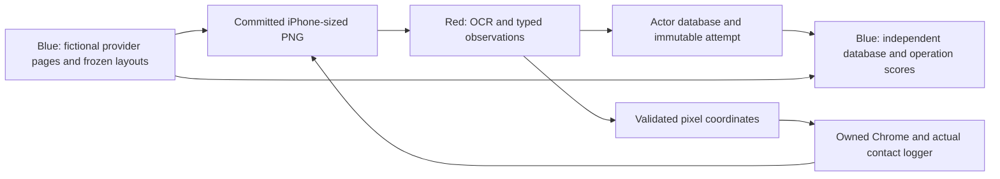

# Gantry Red/Blue infrastructure handoff

Prepared in Toronto on 2026-10-18. Infrastructure version **0.10.0** was
published to main as
[`6101fa5`](https://github.com/mchdeore/iPhone-Ian/commit/6101fa53d2f53f942b7016e815b46211b03c4f3a)
after verification. This document and the additive research organization form
the second publication. Agent work stops after that publication and merge,
at the user's request. The remaining infrastructure tasks are recorded below.

Everything needed for the generated app, dataset, browser executor, OCR
adapter, database and evaluation lives in **iPhone-Ian**. CRAFT was not
accessed or modified and supplies no repository, service, credential or private
code dependency. One gpt-6.1-sol agent performed the work. Training,
fine-tuning and model downloads stayed held throughout this infrastructure
phase. Existing models and the earlier training run are preserved.

## What is implemented

The existing diagram became a controlled synthetic-provider loop:

Blue-private layout, quote truth and contact evidence remain separate from
Red's pixels and public receipts. Native OCR is inference; the navigator used
for acceptance is an explicit coordinate script. No trained navigator or
physical gantry acceptance is claimed.

| Component | Result and location |
| --- | --- |
| Synthetic app and fixtures | Fictional sportsbook providers with deterministic quote phases, tags, frozen source pages, image hashes, split identities and explicit component borders in [phone_lab](../../packages/phone_lab/README.md). |
| Blue/Red local foundation | Existing curator/jobs and actor surfaces, immutable legacy rounds, independent post-commit evaluation, frozen behavior scorer and preserved earlier history. |
| Bounded Blue jobs | Persistent dataset/evaluation queue, explicit executables, one leased child, cancellation, retained partial artifacts and source/manifest fingerprints. The child inherits its ownership lock. Training jobs remain disabled. |
| Pixel browser | Actual isolated Chrome context, Sports/Live/Bets/Account navigation, two price refreshes, tap/swipe/wait requests, fresh stable PNGs, stale/conflicting refusal and immutable replay. |
| Browser evidence ledger | Separate versioned session registry, Blue-private frame truth, precise DOM text borders, actual contact prefixes and verified action-to-frame links. |
| Actor observations | One database per actor-bound session. Raw OCR, associated fields, typed quotes, explicit refusals, latency and detector commitments persist with ingestion receipts and actual database snapshots. |
| Independent scoring | All presented frames count, including blank, refused, empty and unsubmitted frames. Per-attempt snapshots retain their original state after later updates. Reports are immutable and tied to the frozen scorer and committed evidence. |
| Failure records | Missing-module tests, tuple-row persistence failure, malformed operation refusal failure and earlier interrupted WebSocket prototypes remain in private logs. Original databases and failed runs were retained. |

The pixel console and ledger are usable building blocks. The browser-session
supervisor and full Red/Blue battle web UI are still unfinished; existing job
supervision does not provide browser-session recovery automatically.

## What the scores mean

The operation registry separates these six operations:

1. **Identify UI:** class-independent IoU confusion for detector objects with
   a model hash. Raw OCR and OCR-associated boxes do not measure this operation.
2. **Read text:** exact text, missing text and character edit distance, aligned
   by evaluator-only text borders.
3. **Associate fields:** class-independent IoU confusion for OCR-derived roles.
4. **Parse quote:** typed batches, partial outputs and explicit refusals.
5. **Store quote:** atomic inserts, updates, unchanged/stale history and replay.
6. **Verify database:** independently reopened persisted records versus every
   frame's expected records, with wrong/missing fields and retained failures.

`null` output marks an unmeasured operation. An explicitly submitted `[]`
measures an empty result and its misses. Blank views have zero expected rows
and an undefined accuracy denominator, rather than fabricated perfect accuracy.
Each report attributes results to one actor-bound session. Different actors
cannot fill each other's missing rows. Cross-session comparisons must also
control the frozen scenes, view coverage and retry policy.

## Verified acceptance

The final source was independently archived, restored, synced from the frozen
lock and tested. **237 tests passed, no skips**, in 103.75 seconds. Ruff and
offline builds passed. One upstream AnyIO deprecation warning is retained.
All **66 source files** and **34 independently installed wheel runtime files**
were byte-verified.

- Source archive SHA256:
  `8ad57bc5454ed30d6de05481b373280a9a15d118e49543fb0372af55e0d31674`.
- Wheel SHA256:
  `a1c2135a11f668ed97ec65126e5d6ad1220c731956655bc56ace3be7ffb1a769`.

A separate Red process received only PNG metadata and saved PNGs, used the
reviewed Apple Vision OCR binary, committed its own observations and typed
ledger payloads, and then issued two explicit refresh taps. It exited before
independent Blue evaluation. The source and installed wheel reproduced the
three actual PNGs byte-exact and returned the same database scores.

| Presented frame | Exact quote rows in the saved database snapshot | Cumulative trusted contacts |
| --- | --- | --- |
| Initial prices | 4 / 4 | 0 |
| First refresh | 4 / 4 | 2 |
| Second refresh | 3 / 4 | 4 |

The final database contains **3 correct rows, 1 wrong row, 0 missing and 0
unexpected rows**. The suspended quote retains its earlier open status, odds
and timestamp because the current parser refuses the updated row. Each of
`status`, `odds` and `quote_time` has one recorded field error. That failure is
preserved as an optimization and regression target.

Raw OCR matched **91 of 92 text regions** on these three frozen screens. The
one text miss is an odds region. This is a small scene-specific acceptance
result, not a general OCR accuracy estimate. Detector accuracy is **unmeasured**.
The field-association report records navigation **14/14 missed**, participant
**6/6 missed**, line **5/12 missed**, and one miss each for odds, selection and
status. The parser currently omits navigation outputs and does not align some
shared participant/line regions to the individual reference boxes. These
coverage and association errors are kept separate from text recognition.

## Research organization and preserved work

Start at the [Red/Blue research hub](../../research/Teams/README.md):

- [Red Team](<../../research/Teams/Red Team/README.md>): vision/OCR, workflow
  planning, gantry/capture and held training/optimization research.
- [Blue Team](<../../research/Teams/Blue Team/README.md>): provider/security
  context, interaction signals, accessibility controls and synthetic account
  workloads.
- [Shared](../../research/Teams/Shared/README.md): contracts, operations,
  evaluation, market fixtures and experiment design.

All **99 previously published research notes** have at least one assignment.
The inventory records original paths, hashes and reviewed outlines. Some notes
are cross-linked because both teams need them. These are additive indexes:
no original note was moved, rewritten or deleted.

The local vault additionally receives `research/Teams/Local Vault Inventory.md`,
covering **143 original research notes, Bases and paired cards** from the
protected snapshot. The original program board, its card statuses, existing
Red/Blue Bases, research assets and diagram remain in place. The earlier
literature/model/hardware recommendations remain proposals; this handoff's
measured gates govern the current implementation.

Both canvas versions are kept:

- [Published roadmap](../../Gantry%20Vision%20Roadmap.canvas).
- [Shared collaborative planning canvas](../../Shared%20Gantry%20Planning.canvas),
  an exact separate copy of the current 4014-byte shared canvas,
  SHA256 `d42107fa51df062d8ff0db05e7cc1bac6ba383f0ef01c1d5e1541ed6e5b3684a`.

All **153 protected snapshot files** were reverified, including Obsidian state.
The shared canvas was reread from the canonical vault and matched its prior
hash. The dirty canonical source checkout is not pulled, reset, staged or
merged. Additive handoff/index files are copied into its vault separately.
Private workspace state, original runtime data, models, databases, partial
outputs and local history are kept locally.

## Running and extending the building blocks

The complete source/wheel setup and exact observation schema are in the
[package README](../../packages/phone_lab/README.md). From a source checkout,
`uv sync --frozen --extra test` installs the pinned Python3.12 package and
`uv run --frozen pytest -q` runs its tests. Browser capture uses a Chrome
executable with an explicitly reviewed SHA256. Optional native OCR compiles
from [owned_ocr.swift](../../packages/phone_lab/tools/owned_ocr.swift) on macOS.

The operator starts `phone_lab.sportsbook.pixel_cli` with the frozen dataset,
sample ID, fresh output directory, explicit Chrome path/hash and actor ID.
Red reads committed PNGs and sends tap/swipe/wait messages tied to the current
frame and image hash. `BrowserLedger` imports the operator's known executor
directory, commits actor observations and produces Blue-only review reports.
Expose only its public session/frame/pixels/submission methods to Red.

The Python ledger and local console do not supply authentication or an OS
sandbox. A hosted team system still needs isolated filesystem capabilities,
authenticated roles and server-owned worker execution. No real provider
account or production transaction is used by these fictional fixtures.

## Remaining plan, with agent work stopped

1. **Supervised browser sessions:** one owned child/context, bounded command
   queue/runtime/disk/logs, inherited kernel lock and recovery only after
   confirmed child exit. Reserve actions before dispatch, retain uncertain
   outcomes and never repeat a possibly executed input after interruption.
2. **Battle web surfaces:** Red sessions/PNG/coordinates/observations; Blue
   curator, contact review, operation confusions and database reports. Keep
   truth, source pages, selectors and Blue scores out of Red's interface.
3. **Parser and evaluation optimization:** support explicit suspension/null
   odds/current timestamp updates; reconcile shared participant/line regions;
   decide whether navigation association belongs in the extraction contract.
   Re-evaluate the same saved cases before changing models or thresholds.
4. **Broader deterministic scenes:** more providers, fonts, layout families,
   modals and blank/loading views, with tag-driven held-out groups and exact
   text/component borders. Compare latency and field coverage by cohort.
5. **Later model decisions:** first test whether deterministic schema parsing
   fixes the misses. Consider a separate OCR model or lightweight structured
   language model only when held-out evidence warrants it. Training remains
   held until a new user instruction; these notes start no training jobs.
6. **Physical bring-up:** controller/firmware/calibration, real phone holdouts
   and unloaded motion/contact measurements remain missing or unverified.
   Consented human/accessibility controls, provider rights/credentials and
   authenticated hosting are also unavailable or unverified. Record these
   limits without manufacturing acceptance.

The cleanup pass remains **a plan**: inventory active versus historical runs,
trace each dataset/model/database to its manifests and scores, identify
rebuildable caches, and review candidates before any deletion or archival.
Keep all canvases, Obsidian state, the original Red/Blue board, research/assets,
original diagram, models/datasets/databases, negative logs, partial failures
and Git history. No cleanup move, deletion, archive or worktree removal is
performed in this handoff.

After the second push and merge, the ongoing non-CRAFT goal is paused at the
user's explicit request to stop working. No continuation or training is
scheduled by this handoff.
